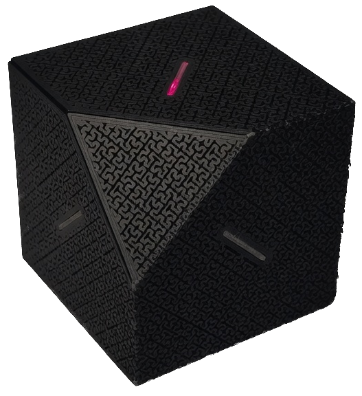
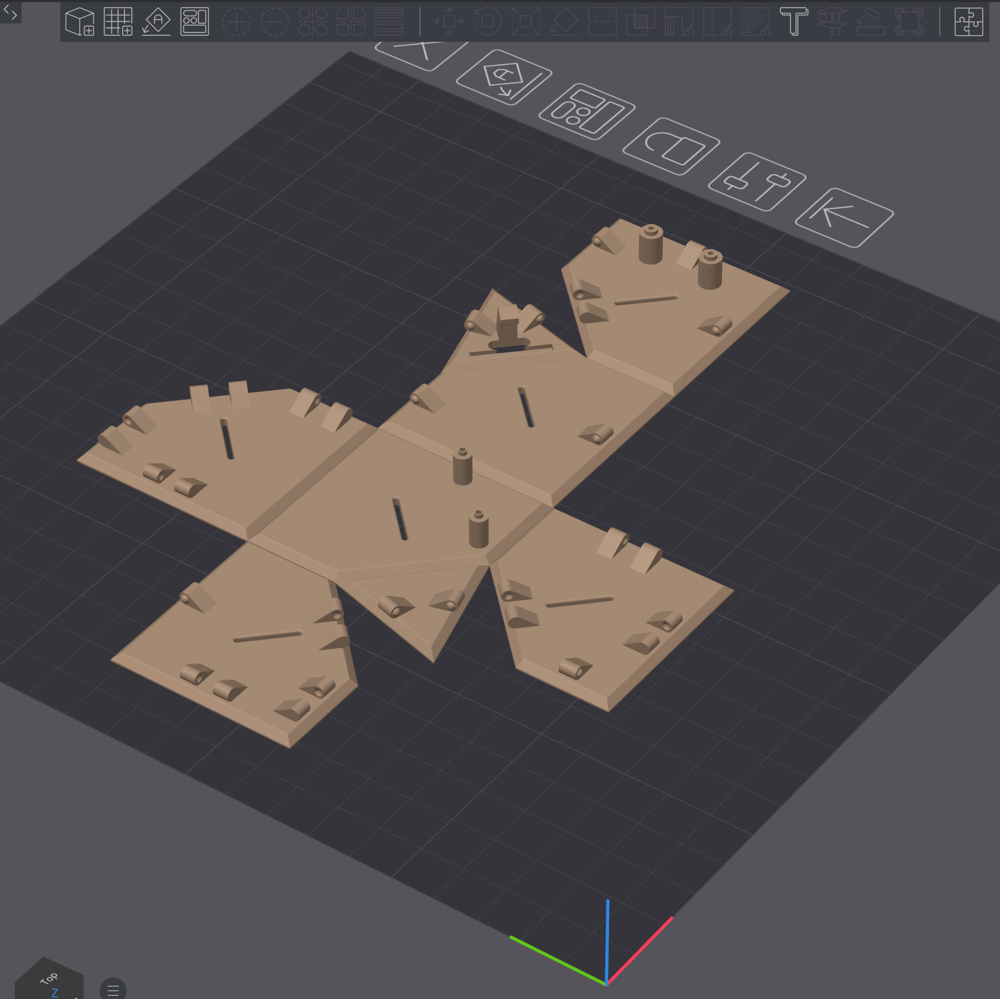
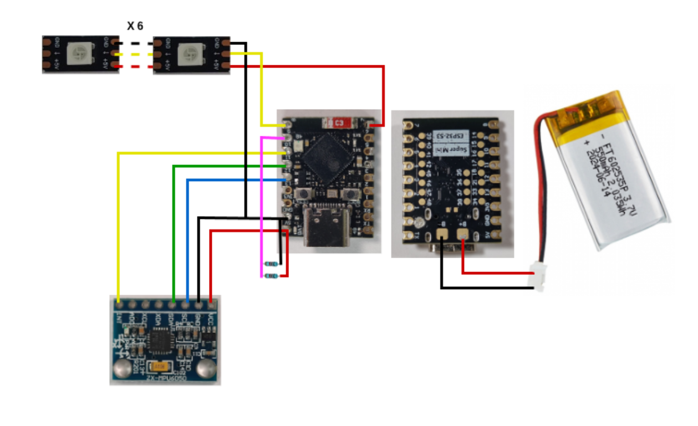
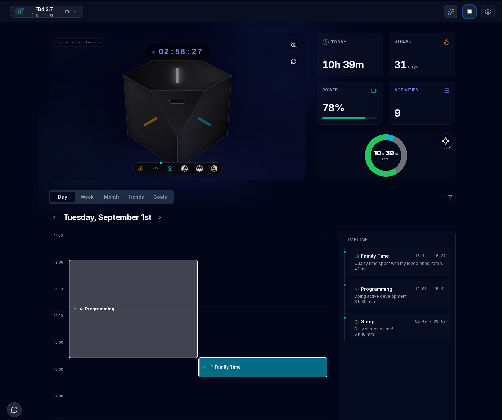

# FlipBuddy

[](./.github/workflows/ci.yml)
[](./LICENSE)
[](./LICENSE-HARDWARE)
[](./docs/CHANGELOG.md)
[](https://micropython.org/)

I kept forgetting to start and stop phone time trackers. FlipBuddy is my fix: a printed cube on the desk. Face up means that activity is on (not a countdown alarm). Flip when you switch; stop face when you are done. The cube logs face changes. LEDs show the colors you set in the free app at [flipbuddy.app](https://flipbuddy.app) if you use it.

I thought it would take a weekend. It took months. That is fine. Still a simple cube: flip a face, log the time, check history later in the free app if you want.

Hackaday wrote about the project:  
https://hackaday.com/2026/08/07/flipbuddy-is-borg-you-will-be-assimilated/

This repository is the open DIY build. Firmware **0.2.2** is the Super Mini freeze (claim pairing + dual-OTA, LittleFS `settings.py` overlay, MicroPython **1.28**). Flash the FlipBuddy **OTA-enabled** image (`esp32_s3_flipbuddy_0.2.2-ota.bin`), not stock MicroPython: faster bring-up, pairing already in the image, pause-tracking and live dashboard preview in this freeze, and over-the-air security and bugfix binaries from flipbuddy.app. Tags **v0.1.0** through **v0.1.5** are historical; they do not work with Production claim pairing or dual-OTA. The shell STLs and assembly PDF are here too. I publish it under **Ponderly Robotics** and work on it when evenings allow, so please treat it as a hobby project, not a product with phone support.

<p align="center">
  
</p>

If you only want to build one, start with the [assembly PDF](./FlipBuddy%20Assembly%20guide.pdf), the files in [stl/](./stl/), **`esp32_s3_flipbuddy_0.2.2-ota.bin`** from GitHub Releases, then `just fast-track` (`main.py` + `settings.py` + a host SoftAP password). Pair from the cube Wi-Fi with an Add Device code. Dashboard JSON is recovery, not the first step. You can ignore `scripts/`, pre-commit, and the rest of the host tooling. People changing the code should read [CONTRIBUTING.md](./CONTRIBUTING.md).

| | |
|--|--|
| Firmware image | GitHub Releases `esp32_s3_flipbuddy_0.2.2-ota.bin` (not in git). Factory `0.2.2.bin` is USB recovery without self-OTA. **v0.1.x is obsolete.** |
| Enclosure | [stl/](./stl/) |
| Assembly | [FlipBuddy Assembly guide.pdf](./FlipBuddy%20Assembly%20guide.pdf) |
| Software license | [MIT](./LICENSE) |
| Hardware license | [CC BY-NC-SA 4.0](./LICENSE-HARDWARE) |

The design is for minutes and hours, not a stopwatch. It prefers boards you can buy today. Other custom modules are not in this tree yet.

## Contents

- [Features in short](#features-in-short)
- [Which firmware (frozen vs stock)](#which-firmware-frozen-vs-stock)
- [Day to day](#day-to-day)
- [Pair from the cube Wi-Fi](#pair-from-the-cube-wi-fi)
- [Firmware updates (OTA)](#firmware-updates-ota)
- [SoftAP maintenance mode](#softap-maintenance-mode)
- [LEDs after you wake the cube](#leds-after-you-wake-the-cube)
- [Battery (rough)](#battery-rough)
- [Getting started](#getting-started)
  - [Serial port and board](#serial-port-and-board-justfile)
  - [Fast track (frozen Super Mini)](#fast-track-v022)
  - [DIY path](#diy-path)
- [Assembly, printing, and parts](#assembly-printing-and-parts)
- [Web app](#web-app)
- [FAQ](#faq)
- [Bugs](#bugs)
- [Contributing](#contributing)
- [License](#license)
- [Links](#links)

## Features in short

- Up to 8 faces (one can be stop)
- Snap-fit printed shell
- RGB LEDs for activity colors from the app
- Deep sleep and longer sleeps on the stop face
- Free web app for names, colors, history, optional AI
- Pair from the cube Wi-Fi (Add Device code). `credentials.json` is recovery only
- Pause tracking from the app: rapid red on the upward face; no new session
- Live face preview in the dashboard when that page is open
- Frozen dual-OTA image can pull an app-slot update from flipbuddy.app (all LEDs solid while it downloads)
- More than one cube per account (stop one in the app before using another a lot)

## Which firmware (frozen vs stock)

On an ESP32-S3 Super Mini, use the **FlipBuddy frozen image** from GitHub Releases. That is the path I flash, pair, and test. Stock MicroPython from micropython.org still works (`just diy`), but you give up speed, easy updates, and the security/bugfix images I actually ship.

| | FlipBuddy frozen (fast track) | Stock MicroPython (DIY) |
|--|--|--|
| Who it is for | Super Mini (4 MB) you want to use as a cube | Other chips, or you want every `.py` on the filesystem |
| Flash | Release `esp32_s3_flipbuddy_*.bin` (prefer `*-ota.bin` when the tag has it) | GENERIC_S3 (or your chip) from micropython.org |
| After flash | `just fast-track` (`main.py` + `settings.py` + SoftAP password) | `just diy` (all modules + SoftAP password) |
| Pairing | Same cube Wi-Fi claim (Add Device code) | Same claim, slower bring-up |
| Over-the-air | Dual-OTA image (`ota_0` / `ota_1`) can **self-write** an app-slot `.bin` from flipbuddy.app | **No** `ota_1` slot. Hash compare only. USB / `just diy` to apply |
| Helpers | SoftAP, pairing, HTTP, NVS already frozen (fast, smaller FS) | Everything copied to LittleFS |
| Bug fixes / security | Next frozen Release + OTA app-slot when dual-OTA is on the cube | You rebuild or re-upload sources yourself |

Stock has a large filesystem and no self-flash. Frozen dual-OTA spends that flash on two app slots so the cube can pull a tested image without a cable. Factory `esp32_s3_flipbuddy_0.2.2.bin` is the USB recovery image (no `ota_1`). Prefer `*-ota.bin`. **v0.1.5** is the old factory table: no self-OTA, and it will not complete Production claim pairing.

Do not write a **merged USB** image (`write-flash 0`) into an OTA slot. That fails `ESP_ERR_OTA_VALIDATE_FAILED`. Later self-updates are an **app-slot** package from flipbuddy.app, not a second GitHub `.bin`. GitHub Releases only ship USB images (`*-ota.bin` and the factory `.bin`).

## Day to day

You set activity names, descriptions, and colors in the browser, plus device settings (for example pause tracking, OTA on/off, how often the cube wakes, and how often it should join Wi-Fi and check in with the server). The cube records which face is up and when (activity periods).

When the cube is online it talks both ways with the free app:
- **Up:** upload face changes (activity periods) for history on flipbuddy.app
- **Down:** pull activity name, description, color, and device configuration for that cube

Wi-Fi is used for those check-ins, sometimes on the stop face, and when USB is plugged in. On stop, sleep intervals grow so the battery lasts longer.

If Wi-Fi is down but credentials are already installed, the cube still boots and can log with defaults (last known face map). Full face colors, fresh names, and history still need flipbuddy.app for normal use.

The **USB-C port** cutout (`front_cutout`) is the **stop** face. The opposite cutout (`back_cutout`) can open **SoftAP maintenance mode** (local captive portal). Unclaimed cubes use the same radio for **pairing** (next section). Rapid red on **one** face (or a cutout triad) means tracking is paused in the app. Blinking **all** LEDs red often means bad orientation or low battery. AI in the app can be turned off.

## Pair from the cube Wi-Fi

First-time setup is **claim pairing**, not a JSON download.

1. Create a free account at [flipbuddy.app](https://flipbuddy.app). **Add Device**, pick the physical cube, give it a name. The wizard shows an 8-character code (`XXXX-XXXX` on screen).
2. Flash the FlipBuddy frozen image, then `just fast-track` (or `just diy` on stock). That puts `main.py`, `settings.py`, and a random SoftAP password on the cube. Serial / the host print the password as `XXXX XXXX` (spaces are only for reading).
3. Keep **USB plugged in**. Join Wi-Fi **`FlipBuddy-XXXX`** (last 4 of the chip id, for example `FlipBuddy-323C`). Type the password **without** the space. While this pairing Wi-Fi is up (~**10 minutes**), **all six LEDs stay solid yellow** (same `#FFFF00` as later claimed SoftAP, which lights the back-cutout triad). If there is no code by then, the cube sleeps until you pick it up (no timer retry). Yellow returns when pairing Wi-Fi is up again.
4. Captive portal, or [http://10.20.30.40/](http://10.20.30.40/): house Wi-Fi plus the dashboard pairing code. House SSID/password stay on the cube. They are never posted to the API.
5. Cube blinks **green**. In the app, confirm / **Start tracking**.

Unclaimed serial looks like:

```
Unclaimed cube.
  Pair from the cube Wi-Fi. Keep USB plugged in.
```

If serial says `FATAL: no SoftAP join password`, run `just gen-ap-psk` and `just put-ap-psk`, then power-cycle. The image will not invent a password.

**Dashboard Reset pairing** only invalidates the server token. Next step is **Add Device**. Forget the account on the cube only if it still thinks it is claimed (SoftAP cutout up, PIN unlock, Forget FlipBuddy account). After a USB reflash, NVS is empty: skip Forget.

JSON from the device page is recovery: `just put-credentials`. `just fast-track` never copies that file.

## Firmware updates (OTA)

On a **frozen dual-OTA** image (USB-flashed `*-ota.bin`, running `ota_0` or `ota_1`):

- Leave **OTA** on in device settings (default on).
- When flipbuddy.app has a newer **app-slot** package, the cube pulls it over HTTPS, checks size and SHA-256, writes the **other** slot, then reboots into it.
- While it downloads, **all six LEDs stay solid** (no activity blink). Blink tasks would steal CPU from the TLS read.
- A bad package (merged USB dump, hash mismatch, `ESP_ERR_OTA_VALIDATE_FAILED`) stays on the current slot. USB may drop when the cube deep-sleeps after the check-in; shake or tap RST.

On **stock MicroPython** (or a factory-table image with no `ota_1`, including **v0.1.5** and `esp32_s3_flipbuddy_0.2.2.bin`):

- The cube can **hash** the advertised file against what it already ran. It does **not** self-flash an app partition.
- Apply updates with USB: newer frozen `*-ota.bin`, or `just diy` / `just put-main` for source.

That is the main reason to prefer the FlipBuddy frozen OTA image: I can ship a tested binary; you do not rebuild MicroPython or copy ten modules by hand for a security or tracking-log fix.

## SoftAP maintenance mode

When the **SoftAP cutout** is up (`back_cutout`, opposite the USB‑C **port**; SoftAP is **on by default** in firmware, advanced builds can disable it), the cube soft‑resets into a short **SoftAP** session so you can check status and fix Wi‑Fi **without** `mpremote`. The USB‑C port cutout (`front_cutout`) is stop, not SoftAP.

Full SoftAP needs the portal modules on the device: a FlipBuddy **frozen** Release (**0.2.2**), **or** DIY/`just diy`. Fast track only pushes `main.py` + `settings.py` + SoftAP password on top of the frozen set (`credentials.json` is recovery, not fast-track). Risks (WPA2 join password, cleartext HTTP after join, PIN): [SECURITY.md](./SECURITY.md).

| | |
|--|--|
| Join Wi-Fi (after `just fast-track`) | SSID **`FlipBuddy-XXXX`** (last 4 of chip id). Password is the host `ap_psk` (`XXXX XXXX` on screen, type without the space). |
| Join Wi-Fi (claimed, no host PSK) | SSID **`FlipBuddy`**. Password **`FB` + last 6 alphanumeric of `device_id`** (example ending `…8b5778` → `FB8B5778`). Independent of the portal PIN. |
| Portal URL | [http://10.20.30.40/](http://10.20.30.40/) (captive portal usually opens this) |
| Session length | About **5 minutes**, then SoftAP stops and the cube deep-sleeps |
| Transport | **HTTP** on the encrypted radio (no TLS server) |
| SoftAP LEDs | Claimed SoftAP cutout: solid **yellow** triad (left, back, bottom). Unclaimed pairing: all six LEDs yellow (see [LEDs](#leds-after-you-wake-the-cube)) |

### Builder steps

1. Put the **SoftAP cutout** up (opposite the USB-C port). Wait until the phone sees **`FlipBuddy-XXXX`** (or legacy **`FlipBuddy`** if this cube has no host `ap_psk`). Shake to wake if the cube slept.
2. Join with the 8-character WPA2 password (host `ap_psk`, or `FB` + last 6 of `device_id` on legacy claimed cubes). Serial prints a PSK hint if you have a USB console. If no captive browser popup, open **http://10.20.30.40/**.
3. Unlock with the **setup PIN** (below) if you need to change Wi‑Fi or PIN.
4. Save home SSID/password if needed. Keep **only one phone** on `FlipBuddy` while settings are unlocked ([why](./SECURITY.md#softap-captive-portal-http-pin-wi-fi)).
5. **Exit:**
   - Tap **Reset device** on the portal (preferred after clock issues), **or** wait for SoftAP to end (~5 min).
   - Flip to a **non‑cutout** face (activity or stop — not either shell cutout).
   - On the phone, leave `FlipBuddy` and rejoin your **home** Wi‑Fi.
6. SoftAP again later: **leave the SoftAP cutout first** (cooldown after a session), then put that cutout up again.

**Timeout vs Reset:** SoftAP timeout turns SoftAP off, deepsleeps briefly, then normal wake (may use home Wi‑Fi / NTP if already configured). **Reset device** (or power‑cycle) runs a full boot with forced Wi‑Fi + NTP — use that when the clock is wrong.

### Default unlock PIN

Settings that **write** to the cube need a **setup PIN** unlock for that SoftAP session:

- **Factory default:** last **6** alphanumeric characters of your **`device_id`**, uppercased (ignore hyphens/punctuation).  
  Example: `device_id` ending in `…ABCDEF123456` → default PIN **`123456`**.
- **Custom PIN:** after unlock, set 4–16 letters/numbers on the portal (stored in NVS); then the factory rule no longer applies.
- Wrong PIN is rate‑limited (**8** tries); then unlock locks until reboot. Portal **Reset device** still works and reboots the cube.
- Unlock idles out after about 5 minutes of no settings use — use **Lock settings** when finished.

You can find `device_id` in the downloaded `credentials.json` or in the flipbuddy.app device page. The cube does not display the PIN.

### What the captive portal shows

**Always available (no PIN):**

- Device **UTC time** and **battery** (percent / voltage; USB‑aware) on the top bar
- Face map / activity colors as stored on the cube
- Local activity records not yet uploaded (when any)
- **Reset device** (not PIN‑protected — physical USB‑face access is assumed)

**After PIN unlock:**

- Add or update **Wi‑Fi** profiles (SSID, password, hidden flag) in NVS
- **Change unlock PIN**
- **LED self‑test**
- **Lock** the settings section again

`device_token` is never shown or edited on SoftAP. To replace API credentials, re‑upload `credentials.json` over USB (`just put-credentials`). `just fast-track` does not copy that file.

## LEDs after you wake the cube

The shell is symmetric on purpose. There is no emblem that says “this is front.” Color is the map.

If you have looked at photos or printed one already, you may think: this thing is symmetric, so which side is front, left, or “programming”? I could have put a different emblem, number, texture, or color on each face. I actually tried. My OCD did not approve of any of them.

What happens instead, after you grab, move, or tap the cube (accelerometer wake — not a quiet timer tick):

1. **Assigned-face map (~7 s).** Every **flat** face that has an activity in the app lights in **that activity’s color** at once (one fade cycle). You do not need to know if “Human Programming” is left or bottom. Green flashing and pointing up is enough. Orange is “AI shenanigans” for me. Whichever physical face that is does not matter.
2. **Live preview.** After that map, keep rotating. As soon as an **assigned** activity face is upward, **only that face** lights solid in its activity color (previous preview off). Unassigned faces and the two cutouts do not get a preview LED. This is how you quickly hunt for a color without waiting for tracking to start.
3. **Still-hold (~10 s).** Hold that face still for about **10 seconds**. Motion, a new face, or “not quite on a face” restarts the 10 s. Then the cube does the **usual tracking blink** on that face, then upload if needed and/or deep sleep.
4. **Give up (~40 s).** If you keep turning it and never hold a face for those 10 s, preview LEDs go out and this wake does **not** start tracking. Put it down and pick it up again.

Quiet **timer** wakes with the dashboard **closed** skip the map and preview: one orientation sample, then the usual track / SoftAP / sleep path. Super Mini often timer-wakes even after a pickup; if the dashboard is open, those wakes still run live preview (no 7 s map).

If tracking is **paused** in the app, pickup skips that map: **rapid red** on the upward face (triad on a cutout), then sleep. That is not the all-LED red error cue.

If the dashboard is open, the cube may join Wi-Fi and send live face previews to the app (during the 7 s map on pickup, or during settle on a Super Mini timer wake). Cube LEDs still do the local map and preview either way.

| | Default |
|--|--|
| Assigned-face map | **~7 s**, one cycle, every assigned activity face |
| Preview | Immediate solid color on the live **assigned** face (pickup, or a watched Super Mini timer wake) |
| Still time | **~10 s** wall-clock, then tracking blink |
| Give up | **~40 s** of fidgeting, then skip tracking for this wake |
| Tracking paused | Rapid **red** on the upward face; no new session |

### SoftAP cutout LEDs

When the **SoftAP cutout** is up (`back_cutout`) and **claimed** SoftAP is running, the cube does **not** use activity colors for that session. It lights the **back-cutout triad** solid **yellow** (`#FFFF00`, `SOFTAP_LED_COLOR` in `rgb.py`) for the whole ~5 minute portal. Unclaimed pairing SoftAP uses the same yellow on **all six** LEDs:

| Orientation | Role | LEDs (activity-face names) | DIN index |
|-------------|------|----------------------------|-----------|
| USB / stop (`front_cutout`) | USB-C port, stop tracking | top, front, right | 4, 0, 5 |
| SoftAP (`back_cutout`) | maintenance portal | left, back, bottom | 3, 2, 1 |

Yellow stays on after the portal LED self-test as well, so you can still see “maintenance is up.” Set `ENABLE_SOFTAP_INDICATOR = False` in `settings.py` if you want SoftAP with the strip dark.

## Battery (rough)

With a ~600 mAh LiPo, order-of-magnitude only:

| Scenario | Avg current | Est. life |
|----------|-------------|-----------|
| Continuous tracking | ~7.4 mA | ~3 days |
| Long stop-face (backoff ~15 min) | ~0.8 mA | ~28 days |
| Mixed use (~10 h tracking/day) | ~3.5 mA | ~6.5 days |

See comments in `main.py` (`prepare_for_deep_sleep`) and `fsm.dot` for the assumptions.

## Getting started

Build and wire the cube first ([assembly section](#assembly-printing-and-parts) and the [PDF](./FlipBuddy%20Assembly%20guide.pdf)). Pins live in `settings.py` (`NP_DATA_PIN` and neighbors).

| Path | Use when | What you put on the device |
|------|----------|----------------------------|
| [Fast track](#fast-track-v022) | ESP32-S3 Super Mini (preferred) | FlipBuddy `esp32_s3_flipbuddy_0.2.2-ota.bin`, then `main.py` + `settings.py` + SoftAP password (`just fast-track`) |
| [DIY path](#diy-path) | Other boards, or every `.py` on the filesystem | Stock MicroPython + all sources + SoftAP password (`just diy`). No self-OTA. |

### Serial port and board (`justfile`)

Defaults target an ESP32-S3 Super Mini (4 MB flash) on Linux. Edit the top of [justfile](./justfile) or set `AMPY_PORT`:

```just
usb_dev := env("AMPY_PORT", "/dev/ttyACM0")
esp_chip := "s3"
esp_flash_size := "4MB"
```

| Setting | Default | Notes |
|---------|---------|--------|
| `usb_dev` / `AMPY_PORT` | `/dev/ttyACM0` | Also try `/dev/ttyUSB0`, `COM3`, `/dev/cu.usbmodem*` |
| `esp_chip` | `s3` | Becomes `esp32s3` for esptool |
| `esp_flash_size` | `4MB` | Match your module when picking MicroPython builds |

```bash
just env
```

The Release fast-track image is ESP32-S3 only. Other chips need the DIY path. Commands below use `/dev/ttyACM0` and `esp32s3`; change them if you are not using `just`.

### Fast track (v0.2.2)

Helpers (including SoftAP and pairing) are frozen into the image. You only place `main.py`, `settings.py`, and a host SoftAP password on the filesystem so you can tweak the entrypoint and pin overlay without rebuilding MicroPython. `credentials.json` is recovery (`just put-credentials`), not part of `just fast-track`. Prefer this over [stock MicroPython](#which-firmware-frozen-vs-stock). **v0.1.x** frozen images are not a supported path to current Production.

| | |
|--|--|
| Image | GitHub **Releases**: **`esp32_s3_flipbuddy_0.2.2-ota.bin`** (dual-OTA USB). Factory `esp32_s3_flipbuddy_0.2.2.bin` is recovery only (no self-OTA). |
| Checksum | Matching `.bin.sha256` or `SHA256SUMS` on the same release |
| Runtime | MicroPython 1.28 |
| Board | ESP32-S3 Super Mini class with battery charger (4 MB flash) |

#### 1. Download, verify, flash

Use this README for flashing. The assembly PDF is for mechanics; if it only mentions stock MicroPython, prefer the frozen Release image for Super Mini.

On GitHub: **Releases** → **v0.2.2**. Download `esp32_s3_flipbuddy_0.2.2-ota.bin` and its checksum. That is the USB image. Later OTA packages come from the app, not from this Release.

```bash
sha256sum -c esp32_s3_flipbuddy_0.2.2-ota.bin.sha256

esptool --chip esp32s3 --port /dev/ttyACM0 erase-flash
esptool --chip esp32s3 --port /dev/ttyACM0 --baud 460800 write-flash 0 esp32_s3_flipbuddy_0.2.2-ota.bin
```

Same with `just` (looks in the current directory, then `build/`):

```bash
just flash-firmware esp32_s3_flipbuddy_0.2.2-ota.bin
```

Factory / recovery (no self-OTA):

```bash
just flash-firmware esp32_s3_flipbuddy_0.2.2.bin
```

Erase-flash wipes NVS (token, house Wi-Fi, SoftAP password). Pair again after every full flash. **v0.1.5 cannot OTA onto this table.**

#### 2. SoftAP password, then pair

Follow [Pair from the cube Wi-Fi](#pair-from-the-cube-wi-fi). Short version:

1. Create a free account at [flipbuddy.app](https://flipbuddy.app) and **Add Device** (physical cube) for the 8-character code.
2. After flash, `just fast-track` uploads `main.py` and `settings.py`, writes a random join password, then hard-resets the cube (`just gen-ap-psk` / `just put-ap-psk` if you want the steps split). **It does not copy `credentials.json`**, even if that file is sitting next to the justfile.
3. Join `FlipBuddy-XXXX` with the printed password. On the cube page, pick home Wi-Fi and type the dashboard pairing code. Keep USB plugged in.
4. JSON download from the device page is recovery only: `just put-credentials`. That skips pairing SoftAP.

#### 3. Upload `main.py`, `settings.py`, and the join password

```bash
just fast-track
# same as: just put-main, then just gen-ap-psk (if needed) && just put-ap-psk, then mpremote reset
```

That only pushes **`main.py`**, **`settings.py`**, and **`ap_psk.json`**, then hard-resets. Do not run `just diy` / `just upload` on the fast track unless you mean to override frozen modules.

Manual equivalent (if you do not use `just`):

```bash
python3 scripts/gen_ap_psk.py
mpremote connect /dev/ttyACM0 cp main.py settings.py :
mpremote connect /dev/ttyACM0 cp ap_psk.json :
mpremote connect /dev/ttyACM0 reset
```

#### 4. After pairing

On first boot after a successful claim it will try Wi-Fi, calibrate, fetch face config, then track flips. LEDs should match dashboard colors. Use `just shell` or any 115200 serial console if something looks wrong. Shake the cube if it went to sleep.

### DIY path

For other boards, stock MicroPython, or editing modules on the filesystem. Super Mini users who only want a working cube should stay on [fast track](#fast-track-v022): stock has **no** `ota_1` slot, so you will not get FlipBuddy OTA app-slot updates.

Get a MicroPython build for your chip and flash size from [micropython.org](https://micropython.org/download/) (**1.28** matches the Release image; 1.27+ usually works on the DIY path). Adjust `justfile` chip/port/flash size as needed.

```bash
esptool --chip esp32s3 --port /dev/ttyACM0 erase-flash
esptool --chip esp32s3 --port /dev/ttyACM0 --baud 460800 write-flash 0 ESP32_GENERIC_S3-....bin
# or: just flash-firmware ESP32_GENERIC_S3-....bin
```

Pairing password: same as fast track (`just diy` generates `ap_psk.json` if needed). JSON recovery remains `just put-credentials`.

```bash
just diy
# same as: just upload, then just gen-ap-psk (if needed) && just put-ap-psk
```

That pushes the firmware modules listed in `device_py` plus the SoftAP password, then hard-resets.

## Assembly, printing, and parts

### Guide

- [FlipBuddy Assembly guide.pdf](./FlipBuddy%20Assembly%20guide.pdf): BOM, print list, photos, fold order
- Flash steps: this README (fast track above)

The PDF **Bill of Materials** and **Parts to Print** sections are the shopping and print lists. Tables below are a short summary plus the firmware pin map.

### Photos

| File | Content |
|------|---------|
| [docs/media/hero-desk.png](./docs/media/hero-desk.png) | Finished cube |
| [docs/media/print-plate.png](./docs/media/print-plate.png) | Net in the slicer |
| [docs/media/wiring-schematic.png](./docs/media/wiring-schematic.png) | Board, MPU, LEDs, battery |
| [docs/media/dashboard.png](./docs/media/dashboard.png) | Web app |

<p align="center">
  
</p>

### STLs (`stl/`)

Shell parts for the Super Mini pinout below (filenames include a design revision tag):

| File | Role |
|------|------|
| `tolerance_20_…_net.stl` … `tolerance_40_…_net.stl` | Shell nets (tighter → looser fit) |
| `flipbuddy_con_v0.1.0_led_clip.stl` | LED clip |
| `flipbuddy_con_v0.1.0_led_light_guide.stl` | Light guide |
| `flipbuddy_con_v0.1.0_new_mpu6050_clip.stl` | Sensor clip |
| `tolerance_check.stl` | Print first to choose a net |
| `flipbuddy_con_v0.1.0_new_led.FCStd` | FreeCAD (LED-related) |

Print the tolerance check, pick a net, then clips and guides. PLA or PETG at ~0.2 mm layers works for many printers. Follow the PDF for glue points and fold order.

### Pins (Super Mini path)

Use the GPIO numbers on the silkscreen. Super Mini clones are not all identical.

| Function | GPIO |
|----------|------|
| NeoPixel VCC gate | 7 |
| NeoPixel data | 8 |
| Battery ADC | 9 |
| MPU INT | 10 |
| I2C SDA | 11 |
| I2C SCL | 12 |
| Onboard LED (if used) | 48 |

LED index order in `settings.py` `LED_PINOUT` (DIN starts at 0): front, bottom, back, left, top, right.

Mount the MPU as in the PDF photos; wrong orientation means wrong faces with “working” firmware.

Worth a quick breadboard test before final soldering: flash frozen image, `just fast-track`, pair, one LED on 7/8, MPU on 10-12, serial at 115200, shake to wake.

<p align="center">
  
</p>

### Parts (summary)

Full list with notes: assembly PDF → **Bill of Materials**.

| Function | Spec | Qty |
|----------|------|----:|
| MCU | ESP32-S3 Supermini, USB-C, onboard charger preferred | 1 |
| IMU | MPU6050 / GY-521 | 1 |
| Battery | 3.7 V protected LiPo ~600 mAh | 1 |
| LEDs | WS2812B 5050 | 6 |
| Optional ADC divider | 470 kΩ | 2 |

Print: one net, six guides, six LED clips, one MPU clip (STLs in `stl/`).

Buy a Super Mini-class board that fits the shell cutout and shows GPIO labels for 7–12. Shop links go stale quickly, so the PDF does not hard-code store URLs.

Expect intermediate DIY skills (print, solder, flash). A careful first build often takes more than one evening after parts arrive.

**Safety:** LiPo packs need care. Do not short them, use a proper charger, and do not leave charging unattended. This is a hobby project; you build at your own risk.

## Web app

[flipbuddy.app](https://flipbuddy.app): live status, history, goals, optional AI. The UI is built for the phone first. In browsers that support it, you can install it as a progressive web app (add to home screen).

<p align="center">
  
</p>

Change faces and colors in the browser; the cube picks them up later. For two cubes, stop one in the app before flipping the other a lot. If the cube seems dead, shake it (motion wake). MCP / external AI details are in the dashboard if you use that.

## FAQ

**I haven't charged my FlipBuddy for a long time, and now it does not connect to the dashboard.**  
The device token is valid for up to **60 days** for security (for example if a cube is lost or stolen). Download a **fresh token** from the dashboard into a new `credentials.json`, run `just put-credentials` (and `just put-main` if you also need a new entrypoint), power-cycle, and tracking can continue. `just fast-track` will not upload that JSON.

**All six LEDs light cyan / light blue when I shake the cube.**  
No activities are assigned on the device yet. Map faces in the free [dashboard](https://flipbuddy.app), make sure Wi‑Fi works on first sync, then shake again. Until that config is applied, the cube only shows the empty “no faces” indicator.

**I flashed the frozen image but the cube never joins my Wi-Fi.**  
Unclaimed cubes type home Wi-Fi on the pairing page after `just fast-track`. House SSID/password stay in NVS on the cube and are never uploaded to the API. Already-claimed recovery: `just put-credentials` restores `device_id` / `device_token` only; a `wifi` entry in that JSON is ignored. After flash, NVS is empty: pair again, or set Wi-Fi from the [SoftAP captive portal](#softap-maintenance-mode) after PIN unlock. Check serial with `just shell` (115200) for connect / missing-PSK messages.

**SoftAP / `FlipBuddy` Wi-Fi does not show up.**  
Shake or wake the cube, put the **SoftAP cutout** up (opposite the USB-C port), and wait a few seconds. After `just fast-track` the SSID is **`FlipBuddy-XXXX`**, not always `FlipBuddy`. After a SoftAP session, the cube uses a **cooldown** while still on that face: flip to another face, then SoftAP cutout up again. Confirm SoftAP modules are on the device (frozen image or DIY/`just diy`). Low battery or a failed SoftAP bring-up falls back to normal boot; serial (`just shell`) shows `ap_session` / SoftAP messages if you have a cable.

**Dashboard said Pairing reset / Forget FlipBuddy account after I USB-flashed.**  
That toast is for a cube that still has an account in NVS. A full erase-flash already wiped it. Skip Forget. **Add Device** and pair again. Forget is SoftAP cutout up, PIN unlock, then Forget FlipBuddy account, only when the cube is still claimed.

**OTA wrote the file then `ESP_ERR_OTA_VALIDATE_FAILED`.**  
The cube received a **merged USB** image (bootloader + table + app), not an app-slot package. Stay on the current slot. USB-flash `*-ota.bin` once, then let flipbuddy.app serve later updates. Stock MicroPython cannot self-flash. Do not put an app-slot file on GitHub Releases or `write-flash 0` it.

**Should I flash stock MicroPython from micropython.org?**  
Not on a Super Mini if you can avoid it. Use the FlipBuddy frozen Release ([why](#which-firmware-frozen-vs-stock)): faster boot, pairing helpers already in the image, and (on dual-OTA) over-the-air bugfix/security binaries. Stock is for other boards or people who want every `.py` on the filesystem.

**I still have a v0.1.0–v0.1.5 cube.**  
Those tags do not work with Production claim pairing or dual-OTA. USB-flash **`esp32_s3_flipbuddy_0.2.2-ota.bin`**, then `just fast-track` and Add Device. You cannot OTA from 0.1.5 onto 0.2.x.

**I saved Wi‑Fi on SoftAP but the cube is still offline.**  
On the phone, leave the **`FlipBuddy`** network and rejoin **home** Wi‑Fi. Flip the cube off the SoftAP cutout (or tap **Reset device**). Confirm the SSID/password and, for hidden networks, the Hidden checkbox. Profile name defaults to `default` on the portal (getting‑started examples often use `home`) - either is fine; the firmware tries configured profiles.

**Recorded times are wrong, or the clock looks fully out of sync.**  
1. Home Wi‑Fi must work first (or fix it via SoftAP). SoftAP top bar cannot prove NTP until the cube has joined home Wi‑Fi on a normal boot.  
2. SoftAP → check the top bar **UTC** time (not your local timezone; the dashboard may show local time).  
3. If **UTC** is wrong and Wi‑Fi works: tap **Reset device**, place the cube on an **activity or stop face (not either cutout)**. Full boot forces **NTP** over home Wi‑Fi. SoftAP **timeout alone** is not the same as that initial boot path.  
4. After a good sync, new sessions get correct timestamps. Old records logged while the RTC was wrong stay wrong — edit them in the [web dashboard](https://flipbuddy.app) if needed.  
5. If UTC looks right but the app “looks wrong,” check timezone/display on the dashboard before assuming the cube clock failed.

## Bugs

Open an issue with what you expected, what happened, board and flash path, serial log if you have one (redact tokens and Wi-Fi passwords). For hardware, photos and which STL/tolerance help.

## Contributing

Builders can stop at the README. Code and tooling: [CONTRIBUTING.md](./CONTRIBUTING.md). Small, focused pull requests are welcome when I have time to review.

## License

| What | License |
|------|---------|
| Software (`.py`, host tools, tests) | [MIT](./LICENSE) |
| Hardware / CAD / assembly PDF / `stl/` | [CC BY-NC-SA 4.0](./LICENSE-HARDWARE) |
| Frozen Release `.bin` | FlipBuddy bits MIT; also MicroPython and other third-party code ([docs/NOTICE](./docs/NOTICE)) |

Copyright 2025–2026 Ponderly Robotics.

If you want to use the enclosure designs commercially, please ask first. The non-commercial share-alike terms on the hardware are intentional.

## Links

- App: https://flipbuddy.app
- Hackaday write-up: https://hackaday.com/2026/08/07/flipbuddy-is-borg-you-will-be-assimilated/
- Firmware binaries: GitHub Releases (`esp32_s3_flipbuddy_0.2.2-ota.bin`, factory `.bin`, checksums)
- [Assembly PDF](./FlipBuddy%20Assembly%20guide.pdf)
- [stl/](./stl/)
- [docs/media/](./docs/media/)
- [CONTRIBUTING.md](./CONTRIBUTING.md)
- [SECURITY.md](./SECURITY.md)
- [docs/CHANGELOG.md](./docs/CHANGELOG.md), [docs/NOTICE](./docs/NOTICE), [docs/RELEASE_NOTES_v0.2.2.md](./docs/RELEASE_NOTES_v0.2.2.md)
- [LICENSE](./LICENSE), [LICENSE-HARDWARE](./LICENSE-HARDWARE)
