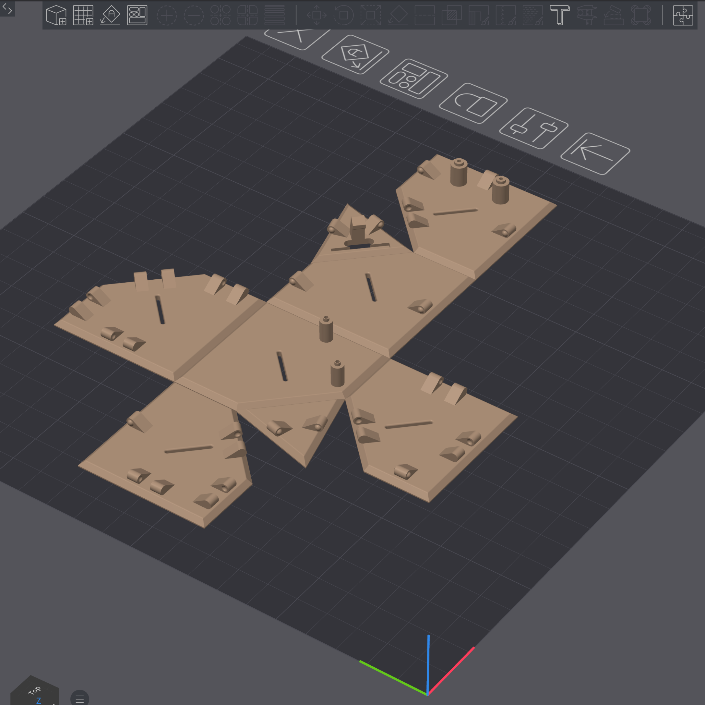
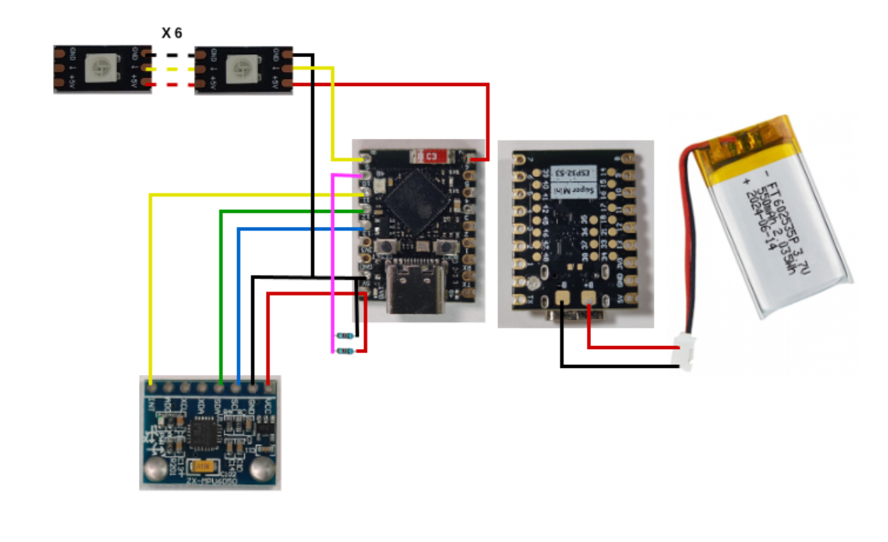

# Build a FlipBuddy

You will have a paired cube: printed shell, FlipBuddy **0.2.3** image, and an Add Device claim. The short path is on the [README](../README.md). This page is the rest: which image, the commands without `just`, other boards, and the parts.

The [assembly PDF](../FlipBuddy%20Assembly%20guide.pdf) is the mechanical guide. If that PDF only mentions stock MicroPython, use the frozen Release image on a Super Mini.

## Contents

- [Which firmware (frozen vs stock)](#which-firmware-frozen-vs-stock)
- [Fast track (v0.2.3)](#fast-track-v023)
- [Pair from the cube Wi-Fi](#pair-from-the-cube-wi-fi)
- [DIY path](#diy-path)
- [Serial port and board](#serial-port-and-board-justfile)
- [Assembly, printing, and parts](#assembly-printing-and-parts)

## Which firmware (frozen vs stock)

On an ESP32-S3 Super Mini, use the **FlipBuddy frozen image** from GitHub Releases. That is the path I flash, pair, and test. Stock MicroPython from micropython.org still works (`just diy`), but you give up speed, easy updates, and the security and bugfix images I actually ship.

| | FlipBuddy frozen (fast track) | Stock MicroPython (DIY) |
|--|--|--|
| Who it is for | Super Mini (4 MB) you want to use as a cube | Other chips, or you want every `.py` on the filesystem |
| Flash | Release `esp32_s3_flipbuddy_*.bin` (prefer `*-ota.bin` when the tag has it) | GENERIC_S3 (or your chip) from micropython.org |
| After flash | `just fast-track` (`main.py` + `settings.py` + `off_check.py` + SoftAP password) | `just diy` (all modules + SoftAP password) |
| Pairing | Same cube Wi-Fi claim (Add Device code) | Same claim, slower bring-up |
| Over-the-air | Dual-OTA image (`ota_0` / `ota_1`) can self-write an app-slot `.bin` from flipbuddy.app | No `ota_1` slot. Hash compare only. USB / `just diy` to apply |
| Helpers | SoftAP, pairing, HTTP, NVS already frozen | Everything copied to LittleFS |
| Bug fixes / security | Next frozen Release, or an OTA app-slot when dual-OTA is on the cube | You rebuild or re-upload sources yourself |

Stock has a large filesystem and no self-flash. Frozen dual-OTA spends that flash on two app slots so the cube can pull a tested image without a cable. Factory `esp32_s3_flipbuddy_0.2.3.bin` is the USB recovery image (no `ota_1`). Prefer `*-ota.bin`. **v0.1.5** is the old factory table: no self-OTA, and it will not complete Production claim pairing.

Do not write a merged USB image (`write-flash 0`) into an OTA slot. That fails `ESP_ERR_OTA_VALIDATE_FAILED`. Later self-updates are an app-slot package from flipbuddy.app, not a second GitHub `.bin`. GitHub Releases only ship USB images (`*-ota.bin` and the factory `.bin`).

## Fast track (v0.2.3)

Helpers (including SoftAP, pairing, and the pause check-back) are frozen into the image. You place `main.py`, `settings.py`, `off_check.py`, and a host SoftAP password on the filesystem so you can tweak the entrypoint, the pin overlay, and the pause check without rebuilding MicroPython. `credentials.json` is recovery (`just put-credentials`), not part of `just fast-track`. **v0.1.x** frozen images are not a supported path to Production claim pairing.

| | |
|--|--|
| Image | GitHub **Releases**: **`esp32_s3_flipbuddy_0.2.3-ota.bin`** (dual-OTA USB). Factory `esp32_s3_flipbuddy_0.2.3.bin` is recovery only (no self-OTA). |
| Checksum | Matching `.bin.sha256` or `SHA256SUMS` on the same release |
| Runtime | MicroPython 1.28 |
| Board | ESP32-S3 Super Mini class with battery charger (4 MB flash) |

The Release fast-track image is ESP32-S3 only. Other chips need the [DIY path](#diy-path). Commands below use `/dev/ttyACM0` and `esp32s3`. Change them if you are not using `just`. See [Serial port and board](#serial-port-and-board-justfile).

### 1. Download, verify, flash

On GitHub: **Releases** → **v0.2.3**. Download `esp32_s3_flipbuddy_0.2.3-ota.bin` and its checksum. That is the USB image. Later OTA packages come from the app, not from this Release.

```bash
sha256sum -c esp32_s3_flipbuddy_0.2.3-ota.bin.sha256

esptool --chip esp32s3 --port /dev/ttyACM0 erase-flash
esptool --chip esp32s3 --port /dev/ttyACM0 --baud 460800 write-flash 0 esp32_s3_flipbuddy_0.2.3-ota.bin
```

Same with `just` (looks in the current directory, then `build/`):

```bash
just flash-firmware esp32_s3_flipbuddy_0.2.3-ota.bin
```

Factory / recovery (no self-OTA):

```bash
just flash-firmware esp32_s3_flipbuddy_0.2.3.bin
```

Erase-flash wipes NVS (token, house Wi-Fi, SoftAP password). Pair again after every full flash. **v0.1.5 cannot OTA onto this table.**

### 2. SoftAP password, then pair

Follow [Pair from the cube Wi-Fi](#pair-from-the-cube-wi-fi). Short version:

1. Create a free account at [flipbuddy.app](https://flipbuddy.app) and **Add Device** (physical cube) for the 8-character code.
2. After flash, `just fast-track` uploads `main.py`, `settings.py`, and `off_check.py`, writes a random join password, then hard-resets the cube (`just gen-ap-psk` / `just put-ap-psk` if you want the steps split). **It does not copy `credentials.json`**, even if that file is sitting next to the justfile.
3. Join `FlipBuddy-XXXX` with the printed password. On the cube page, pick home Wi-Fi and type the dashboard pairing code. Keep USB plugged in.
4. JSON download from the device page is recovery only: `just put-credentials`. That skips pairing SoftAP.

### 3. What `just fast-track` copies

```bash
just fast-track
# same as: just put-main, then just gen-ap-psk (if needed) && just put-ap-psk, then mpremote reset
```

That pushes **`main.py`**, **`settings.py`**, **`off_check.py`**, and **`ap_psk.json`**, then hard-resets. Do not run `just diy` / `just upload` on the fast track unless you mean to override frozen modules.

Manual equivalent (if you do not use `just`):

```bash
python3 scripts/gen_ap_psk.py
mpremote connect /dev/ttyACM0 cp main.py settings.py off_check.py :
mpremote connect /dev/ttyACM0 cp ap_psk.json :
mpremote connect /dev/ttyACM0 reset
```

### 4. After pairing

On first boot after a successful claim the cube tries Wi-Fi, calibrates, fetches the face config, then tracks flips. LEDs should match dashboard colors. Use `just shell` or any 115200 serial console if something looks wrong. Shake the cube if it went to sleep.

What the lights mean after that is in [Use the cube](./USE.md#leds-after-you-wake-the-cube).

## Pair from the cube Wi-Fi

First-time setup is claim pairing, not a JSON download.

1. Create a free account at [flipbuddy.app](https://flipbuddy.app). **Add Device**, pick the physical cube, give it a name. The wizard shows an 8-character code (`XXXX-XXXX` on screen).
2. Flash the FlipBuddy frozen image, then `just fast-track` (or `just diy` on stock). That puts `main.py`, `settings.py`, `off_check.py`, and a random SoftAP password on the cube. Serial / the host print the password as `XXXX XXXX` (spaces are only for reading).
3. Keep **USB plugged in**. Join Wi-Fi **`FlipBuddy-XXXX`** (last 4 of the chip id, for example `FlipBuddy-323C`). Type the password **without** the space. While this pairing Wi-Fi is up (~**10 minutes**), **all six LEDs stay solid yellow**. If there is no code by then, the cube sleeps until you pick it up (no timer retry). Yellow returns when pairing Wi-Fi is up again.
4. Captive portal, or [http://10.20.30.40/](http://10.20.30.40/): house Wi-Fi plus the dashboard pairing code. House SSID and password stay on the cube. They are never posted to the API.
5. Cube blinks **green**. In the app, confirm / **Start tracking**.

Unclaimed serial looks like:

```
Unclaimed cube.
  Pair from the cube Wi-Fi. Keep USB plugged in.
```

If serial says `FATAL: no SoftAP join password`, run `just gen-ap-psk` and `just put-ap-psk`, then power-cycle. The image will not invent a password.

**Dashboard Reset pairing** only invalidates the server token. Next step is **Add Device**. Forget the account on the cube only if it still thinks it is claimed (SoftAP cutout up, PIN unlock, Forget FlipBuddy account). After a USB reflash, NVS is empty: skip Forget. The maintenance page is [Use the cube](./USE.md#softap-maintenance-mode).

JSON from the device page is recovery: `just put-credentials`. `just fast-track` never copies that file.

## DIY path

For other boards, stock MicroPython, or editing modules on the filesystem. Super Mini users who only want a working cube should stay on [fast track](#fast-track-v023). Stock has **no** `ota_1` slot, so you will not get FlipBuddy OTA app-slot updates.

Get a MicroPython build for your chip and flash size from [micropython.org](https://micropython.org/download/) (**1.28** matches the Release image; 1.27+ usually works on the DIY path). Adjust `justfile` chip, port, and flash size as needed.

```bash
esptool --chip esp32s3 --port /dev/ttyACM0 erase-flash
esptool --chip esp32s3 --port /dev/ttyACM0 --baud 460800 write-flash 0 ESP32_GENERIC_S3-....bin
# or: just flash-firmware ESP32_GENERIC_S3-....bin
```

Pairing password: same as fast track (`just diy` generates `ap_psk.json` if needed). JSON recovery remains `just put-credentials`.

```bash
just diy
# same as: just upload, then just gen-ap-psk (if needed) && just put-ap-psk
```

That pushes the firmware modules listed in `device_py` plus the SoftAP password, then hard-resets.

## Serial port and board (`justfile`)

Defaults target an ESP32-S3 Super Mini (4 MB flash) on Linux. Edit the top of [justfile](../justfile) or set `AMPY_PORT`:

```just
usb_dev := env("AMPY_PORT", "/dev/ttyACM0")
esp_chip := "s3"
esp_flash_size := "4MB"
```

| Setting | Default | Notes |
|---------|---------|--------|
| `usb_dev` / `AMPY_PORT` | `/dev/ttyACM0` | Also try `/dev/ttyUSB0`, `COM3`, `/dev/cu.usbmodem*` |
| `esp_chip` | `s3` | Becomes `esp32s3` for esptool |
| `esp_flash_size` | `4MB` | Match your module when picking MicroPython builds |

```bash
just env
```

## Assembly, printing, and parts

### Guide

- [FlipBuddy Assembly guide.pdf](../FlipBuddy%20Assembly%20guide.pdf): BOM, print list, photos, fold order
- Flash steps: [Fast track](#fast-track-v023) above

The PDF **Bill of Materials** and **Parts to Print** sections are the shopping and print lists. Tables below are a short summary plus the firmware pin map.

### Photos

| File | Content |
|------|---------|
| [media/hero-desk.png](./media/hero-desk.png) | Finished cube |
| [media/print-plate.png](./media/print-plate.png) | Net in the slicer |
| [media/wiring-schematic.png](./media/wiring-schematic.png) | Board, MPU, LEDs, battery |
| [media/dashboard.png](./media/dashboard.png) | Web app |

<p align="center">
  
</p>

### STLs (`stl/`)

Shell parts for the Super Mini pinout below (filenames include a design revision tag):

| File | Role |
|------|------|
| `tolerance_20_…_net.stl` … `tolerance_40_…_net.stl` | Shell nets (tighter → looser fit) |
| `flipbuddy_con_v0.1.0_led_clip.stl` | LED clip |
| `flipbuddy_con_v0.1.0_led_light_guide.stl` | Light guide |
| `flipbuddy_con_v0.1.0_new_mpu6050_clip.stl` | Sensor clip |
| `tolerance_check.stl` | Print first to choose a net |
| `flipbuddy_con_v0.1.0_new_led.FCStd` | FreeCAD (LED-related) |

Files are in [stl/](../stl/). Print the tolerance check, pick a net, then clips and guides. PLA or PETG at about 0.2 mm layers works for many printers. Follow the PDF for glue points and fold order.

### Pins (Super Mini path)

Use the GPIO numbers on the silkscreen. Super Mini clones are not all identical. The same numbers are in [settings.py](../settings.py).

| Function | GPIO |
|----------|------|
| NeoPixel VCC gate | 7 |
| NeoPixel data | 8 |
| Battery ADC | 9 |
| MPU INT | 10 |
| I2C SDA | 11 |
| I2C SCL | 12 |
| Onboard LED (if used) | 48 |

LED index order in `settings.py` `LED_PINOUT` (DIN starts at 0): front, bottom, back, left, top, right.

Mount the MPU as in the PDF photos. Wrong orientation means wrong faces with working firmware.

Worth a quick breadboard test before final soldering: flash the frozen image, `just fast-track`, pair, one LED on 7/8, MPU on 10–12, serial at 115200, shake to wake.

<p align="center">
  
</p>

### Parts (summary)

Full list with notes: assembly PDF → **Bill of Materials**.

| Function | Spec | Qty |
|----------|------|----:|
| MCU | ESP32-S3 Supermini, USB-C, onboard charger preferred | 1 |
| IMU | MPU6050 / GY-521 | 1 |
| Battery | 3.7 V protected LiPo ~600 mAh | 1 |
| LEDs | WS2812B 5050 | 6 |
| Optional ADC divider | 470 kΩ | 2 |

Print: one net, six guides, six LED clips, one MPU clip.

Buy a Super Mini-class board that fits the shell cutout and shows GPIO labels for 7–12. Shop links go stale quickly, so the PDF does not hard-code store URLs.

Expect intermediate DIY skills (print, solder, flash). A careful first build often takes more than one evening after parts arrive.

**Safety:** LiPo packs need care. Do not short them, use a proper charger, and do not leave charging unattended. This is a hobby project. You build at your own risk.

After the cube is paired, day-to-day behavior is in [Use the cube](./USE.md).
