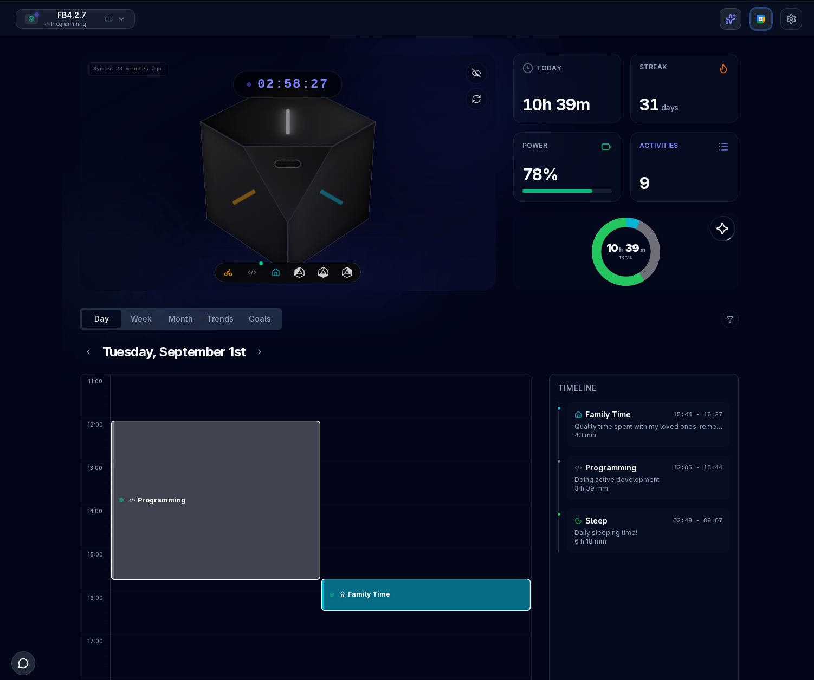

# Use the cube

Face up is the activity. Flip when you switch. The stop face (USB-C port) means you are done. First-time flash and pair are in the [README](../README.md) and [Build a FlipBuddy](./BUILD.md). This page is what the cube does after that.

## Contents

- [Day to day](#day-to-day)
- [LEDs after you wake the cube](#leds-after-you-wake-the-cube)
- [SoftAP maintenance mode](#softap-maintenance-mode)
- [Firmware updates (OTA)](#firmware-updates-ota)
- [Battery (rough)](#battery-rough)
- [Web app](#web-app)
- [FAQ](#faq)

## Day to day

You set activity names, descriptions, and colors in the browser, plus device settings (for example pause tracking, OTA on or off, how often the cube wakes, and how often it should join Wi-Fi and check in). The cube records which face is up and when.

When the cube is online it talks both ways with the free app:

- **Up:** upload face changes (activity periods) for history on flipbuddy.app
- **Down:** pull activity name, description, color, and device configuration for that cube

Wi-Fi is used for those check-ins, sometimes on the stop face, and when USB is plugged in. On stop, sleep intervals grow so the battery lasts longer.

If Wi-Fi is down but credentials are already on the cube, it still boots and can log with the last known face map. Full face colors, fresh names, and history still need flipbuddy.app for normal use.

The **USB-C port** cutout (`front_cutout`) is the **stop** face. The opposite cutout (`back_cutout`) can open **SoftAP maintenance mode**. Unclaimed cubes use the same radio for pairing ([build steps](./BUILD.md#pair-from-the-cube-wi-fi)). Rapid red on **one** face (or a cutout triad) means tracking is paused in the app. Blinking **all** LEDs red often means bad orientation or low battery. AI in the app can be turned off.

## LEDs after you wake the cube

The shell is symmetric on purpose. There is no emblem that says "this is front." Color is the map.

If you have looked at photos or printed one already, you may think: this thing is symmetric, so which side is front, left, or "programming"? I could have put a different emblem, number, texture, or color on each face. I actually tried. My OCD did not approve of any of them.

What happens instead, after you grab, move, or tap the cube (accelerometer wake, not a quiet timer tick):

1. **Assigned-face map (~7 s).** Every **flat** face that has an activity in the app lights in **that activity's color** at once (one fade cycle). You do not need to know if "Human Programming" is left or bottom. Green flashing and pointing up is enough. Whichever physical face that is does not matter.
2. **Live preview.** After that map, keep rotating. As soon as an **assigned** activity face is upward, **only that face** lights solid in its activity color (previous preview off). Unassigned faces and the two cutouts do not get a preview LED. This is how you hunt for a color without waiting for tracking to start.
3. **Still-hold (~10 s).** Hold that face still for about **10 seconds**. Motion, a new face, or "not quite on a face" restarts the 10 s. Then the cube does the **usual tracking blink** on that face, then upload if needed and/or deep sleep.
4. **Give up (~40 s).** If you keep turning it and never hold a face for those 10 s, preview LEDs go out and this wake does **not** start tracking. Put it down and pick it up again.

Quiet **timer** wakes with the dashboard **closed** skip the map and preview: one orientation sample, then the usual track / SoftAP / sleep path. Super Mini often timer-wakes even after a pickup. If the dashboard is open, those wakes still run live preview (no 7 s map).

If tracking is **paused** in the app, pickup skips that map: **rapid red** on the upward face (triad on a cutout), then sleep. A pickup does not restart the check-back timer and does not join Wi-Fi. A saved log goes out when that check is already due, or while USB is plugged in. That is not the all-LED red error cue.

If the dashboard is open, the cube may join Wi-Fi and send live face previews to the app (during the 7 s map on pickup, or during settle on a Super Mini timer wake). Cube LEDs still do the local map and preview either way.

| | Default |
|--|--|
| Assigned-face map | **~7 s**, one cycle, every assigned activity face |
| Preview | Immediate solid color on the live **assigned** face (pickup, or a watched Super Mini timer wake) |
| Still time | **~10 s** wall-clock, then tracking blink |
| Give up | **~40 s** of fidgeting, then skip tracking for this wake |
| Tracking paused | Rapid **red** on the upward face; no new session. A pickup does not reset the check-back timer |

### SoftAP cutout LEDs

When the **SoftAP cutout** is up (`back_cutout`) and **claimed** SoftAP is running, the cube does **not** use activity colors for that session. It lights the **back-cutout triad** solid **yellow** (`#FFFF00`) for the whole ~5 minute portal. Unclaimed pairing SoftAP uses the same yellow on **all six** LEDs:

| Orientation | Role | LEDs (activity-face names) | DIN index |
|-------------|------|----------------------------|-----------|
| USB / stop (`front_cutout`) | USB-C port, stop tracking | top, front, right | 4, 0, 5 |
| SoftAP (`back_cutout`) | maintenance portal | left, back, bottom | 3, 2, 1 |

Yellow stays on after the portal LED self-test as well, so you can still see that maintenance is up. Set `ENABLE_SOFTAP_INDICATOR = False` in `settings.py` if you want SoftAP with the strip dark.

## SoftAP maintenance mode

When the **SoftAP cutout** is up (`back_cutout`, opposite the USB-C **port**; SoftAP is **on by default**), the cube soft-resets into a short **SoftAP** session so you can check status and fix Wi-Fi without `mpremote`. The USB-C port cutout (`front_cutout`) is stop, not SoftAP.

Full SoftAP needs the portal modules on the device: a FlipBuddy **frozen** Release (**0.2.3**), or DIY / `just diy`. Fast track only pushes `main.py` + `settings.py` + `off_check.py` + SoftAP password on top of the frozen set (`credentials.json` is recovery, not fast-track). Risks (WPA2 join password, cleartext HTTP after join, PIN): [SECURITY.md](../SECURITY.md).

| | |
|--|--|
| Join Wi-Fi (after `just fast-track`) | SSID **`FlipBuddy-XXXX`** (last 4 of chip id). Password is the host `ap_psk` (`XXXX XXXX` on screen, type without the space). |
| Join Wi-Fi (claimed, no host PSK) | SSID **`FlipBuddy`**. Password **`FB` + last 6 alphanumeric of `device_id`** (example ending `…8b5778` → `FB8B5778`). Independent of the portal PIN. |
| Portal URL | [http://10.20.30.40/](http://10.20.30.40/) (captive portal usually opens this) |
| Session length | About **5 minutes**, then SoftAP stops and the cube deep-sleeps |
| Transport | **HTTP** on the encrypted radio (no TLS server) |
| SoftAP LEDs | Claimed SoftAP cutout: solid **yellow** triad (left, back, bottom). Unclaimed pairing: all six LEDs yellow (see [LEDs](#leds-after-you-wake-the-cube)) |

### Builder steps

1. Put the **SoftAP cutout** up (opposite the USB-C port). Wait until the phone sees **`FlipBuddy-XXXX`** (or legacy **`FlipBuddy`** if this cube has no host `ap_psk`). Shake to wake if the cube slept.
2. Join with the 8-character WPA2 password (host `ap_psk`, or `FB` + last 6 of `device_id` on legacy claimed cubes). Serial prints a PSK hint if you have a USB console. If no captive browser popup, open **http://10.20.30.40/**.
3. Unlock with the **setup PIN** (below) if you need to change Wi-Fi or PIN.
4. Save home SSID and password if needed. Keep **only one phone** on `FlipBuddy` while settings are unlocked ([why](../SECURITY.md#softap-captive-portal-http-pin-wi-fi)).
5. **Exit:**
   - Tap **Reset device** on the portal (preferred after clock issues), **or** wait for SoftAP to end (~5 min).
   - Flip to a **non-cutout** face (activity or stop, not either shell cutout).
   - On the phone, leave `FlipBuddy` and rejoin your **home** Wi-Fi.
6. SoftAP again later: **leave the SoftAP cutout first** (cooldown after a session), then put that cutout up again.

**Timeout vs Reset:** SoftAP timeout turns SoftAP off, deep-sleeps briefly, then a normal wake (home Wi-Fi and NTP if already configured). **Reset device** (or a power-cycle) runs a full boot with forced Wi-Fi and NTP. Use that when the clock is wrong.

### Default unlock PIN

Settings that **write** to the cube need a **setup PIN** unlock for that SoftAP session:

- **Factory default:** last **6** alphanumeric characters of your **`device_id`**, uppercased (ignore hyphens and punctuation). Example: `device_id` ending in `…ABCDEF123456` → default PIN **`123456`**.
- **Custom PIN:** after unlock, set 4–16 letters or numbers on the portal (stored on the cube). Then the factory rule no longer applies.
- Wrong PIN is rate-limited (**8** tries). Then unlock locks until reboot. Portal **Reset device** still works and reboots the cube.
- Unlock idles out after about 5 minutes of no settings use. Use **Lock settings** when finished.

You can find `device_id` in the downloaded `credentials.json` or on the flipbuddy.app device page. The cube does not display the PIN.

### What the captive portal shows

**Always available (no PIN):**

- Device **UTC time** and **battery** (percent and voltage; USB-aware) on the top bar
- Face map and activity colors as stored on the cube
- Local activity records not yet uploaded (when any)
- **Reset device** (not PIN-protected; you have the cube in your hand)

**After PIN unlock:**

- Add or update **Wi-Fi** profiles (SSID, password, hidden flag) on the cube
- **Change unlock PIN**
- **LED self-test**
- **Lock** the settings section again

`device_token` is never shown or edited on SoftAP. To replace API credentials, re-upload `credentials.json` over USB (`just put-credentials`). `just fast-track` does not copy that file.

## Firmware updates (OTA)

On a **frozen dual-OTA** image (USB-flashed `*-ota.bin`, running `ota_0` or `ota_1`):

- Leave **OTA** on in device settings (default on).
- When flipbuddy.app has a newer **app-slot** package, the cube pulls it over HTTPS, checks size and SHA-256, writes the **other** slot, then reboots into it.
- While it downloads, **all six LEDs stay solid** (no activity blink). A blink would steal time from the download.
- A bad package (merged USB dump, hash mismatch, `ESP_ERR_OTA_VALIDATE_FAILED`) stays on the current slot. USB may drop when the cube deep-sleeps after the check-in. Shake the cube or tap RST.

On **stock MicroPython** (or a factory-table image with no `ota_1`, including **v0.1.5** and `esp32_s3_flipbuddy_0.2.3.bin`):

- The cube can **hash** the advertised file against what it already ran. It does **not** self-flash an app partition.
- Apply updates with USB: a newer frozen `*-ota.bin`, or `just diy` / `just put-main` for source.

That is the main reason to prefer the FlipBuddy frozen OTA image. I can ship a tested binary. You do not rebuild MicroPython or copy every module by hand for a security or tracking-log fix.

## Battery (rough)

With a ~600 mAh LiPo, order-of-magnitude only:

| Scenario | Avg current | Est. life |
|----------|-------------|-----------|
| Continuous tracking | ~7.4 mA | ~3 days |
| Long stop-face (backoff ~15 min) | ~0.8 mA | ~28 days |
| Mixed use (~10 h tracking/day) | ~3.5 mA | ~6.5 days |

The assumptions are in comments in `main.py` (`prepare_for_deep_sleep`) and in [fsm.dot](../fsm.dot).

## Web app

[flipbuddy.app](https://flipbuddy.app): live status, history, goals, optional AI. The UI is built for the phone first. In browsers that support it, you can install it as a progressive web app (add to home screen).

  

Change faces and colors in the browser. The cube picks them up on a later check-in. For two cubes, stop one in the app before flipping the other a lot. If the cube seems dead, shake it (motion wake).

## FAQ

**I have not charged my FlipBuddy for a long time, and now it does not connect to the dashboard.**
The device token is valid for up to **60 days** (for example if a cube is lost). Download a **fresh token** from the dashboard into a new `credentials.json`, run `just put-credentials` (and `just put-main` if you also need a new entrypoint), power-cycle, and tracking can continue. `just fast-track` will not upload that JSON.

**All six LEDs light cyan / light blue when I shake the cube.**
No activities are assigned on the device yet. Map faces in the free [dashboard](https://flipbuddy.app), make sure Wi-Fi works on first sync, then shake again. Until that config is applied, the cube only shows the empty "no faces" indicator.

**I flashed the frozen image but the cube never joins my Wi-Fi.**
Unclaimed cubes take house Wi-Fi on the pairing page after `just fast-track`. House SSID and password stay on the cube and are never uploaded to the API. Already-claimed recovery: `just put-credentials` restores `device_id` and `device_token` only. A `wifi` entry in that JSON is ignored. After flash, NVS is empty: pair again, or set Wi-Fi from the [SoftAP captive portal](#softap-maintenance-mode) after PIN unlock. Check serial with `just shell` (115200) for connect or missing-PSK messages.

**SoftAP / `FlipBuddy` Wi-Fi does not show up.**
Shake or wake the cube, put the **SoftAP cutout** up (opposite the USB-C port), and wait a few seconds. After `just fast-track` the SSID is **`FlipBuddy-XXXX`**, not always `FlipBuddy`. After a SoftAP session, the cube uses a **cooldown** while still on that face: flip to another face, then SoftAP cutout up again. Confirm SoftAP modules are on the device (frozen image or DIY / `just diy`). Low battery or a failed SoftAP bring-up falls back to normal boot. Serial (`just shell`) shows `ap_session` / SoftAP messages if you have a cable.

**Dashboard said Pairing reset / Forget FlipBuddy account after I USB-flashed.**
That toast is for a cube that still has an account in NVS. A full erase-flash already wiped it. Skip Forget. **Add Device** and pair again. Forget is SoftAP cutout up, PIN unlock, then Forget FlipBuddy account, only when the cube is still claimed.

**OTA wrote the file then `ESP_ERR_OTA_VALIDATE_FAILED`.**
The cube received a **merged USB** image (bootloader + table + app), not an app-slot package. Stay on the current slot. USB-flash `*-ota.bin` once, then let flipbuddy.app serve later updates. Stock MicroPython cannot self-flash. Do not put an app-slot file on GitHub Releases or `write-flash 0` it.

**Should I flash stock MicroPython from micropython.org?**
Not on a Super Mini if you can avoid it. Use the FlipBuddy frozen Release ([why](./BUILD.md#which-firmware-frozen-vs-stock)): faster boot, pairing helpers already in the image, and (on dual-OTA) over-the-air bugfix and security binaries. Stock is for other boards or for people who want every `.py` on the filesystem.

**I still have a v0.1.0–v0.1.5 cube.**
Those tags do not work with Production claim pairing or dual-OTA. USB-flash **`esp32_s3_flipbuddy_0.2.3-ota.bin`**, then `just fast-track` and Add Device. You cannot OTA from 0.1.5 onto 0.2.x. Steps: [Build a FlipBuddy](./BUILD.md).

**I saved Wi-Fi on SoftAP but the cube is still offline.**
On the phone, leave the **`FlipBuddy`** network and rejoin **home** Wi-Fi. Flip the cube off the SoftAP cutout (or tap **Reset device**). Confirm the SSID and password and, for hidden networks, the Hidden checkbox. Profile name defaults to `default` on the portal. Either name is fine. The firmware tries the configured profiles.

**Recorded times are wrong, or the clock looks fully out of sync.**

1. Home Wi-Fi must work first (or fix it via SoftAP). The SoftAP top bar cannot prove NTP until the cube has joined home Wi-Fi on a normal boot.
2. SoftAP → check the top bar **UTC** time (not your local timezone; the dashboard may show local time).
3. If **UTC** is wrong and Wi-Fi works: tap **Reset device**, place the cube on an **activity or stop face (not either cutout)**. Full boot forces **NTP** over home Wi-Fi. SoftAP **timeout alone** is not that boot path.
4. After a good sync, new sessions get correct timestamps. Old records logged while the RTC was wrong stay wrong. Edit them in the [web dashboard](https://flipbuddy.app) if you need to.
5. If UTC looks right but the app looks wrong, check timezone and display on the dashboard before you assume the cube clock failed.

## Bugs

Open an issue with what you expected, what happened, board and flash path, and a serial log if you have one (redact tokens and Wi-Fi passwords). For hardware, photos and which STL or tolerance help. Code changes: [CONTRIBUTING.md](../CONTRIBUTING.md).
